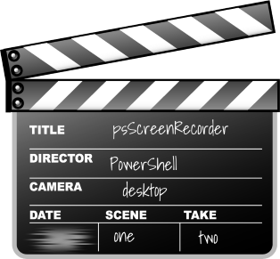

# psScreenRecorder



> Screen recording and GIF making from PowerShell, built on ffmpeg. Windows, macOS and Linux.

[](https://www.powershellgallery.com/packages/psScreenRecorder)


---

## Status: version 2 prereleases

Version 2 is a complete rewrite. PowerShell sets up the recording and controls ffmpeg, and ffmpeg does the capturing and encoding. Version 1 took screenshots in a PowerShell loop and stitched them into a video.

| Available now | Coming next |
| --- | --- |
| Record a monitor, a window, your current terminal, or a region you type or drag out: `Start-ScreenRecording`, `Stop-ScreenRecording`, `Get-ScreenRecording`, `Get-CaptureTarget`, `Select-ScreenRegion`. Record a script block for README demos: `Invoke-ScreenRecording`. Recover recordings left behind: `Repair-ScreenRecording`. Make GIFs and read video details: `ConvertTo-Gif`, `Get-VideoMetadata`, `Find-FFmpeg` | WebP, trimming, compressing, frame export |

The plan is in the [roadmap](./Roadmap.md).

Version 1.0.8, the last version on the PowerShell Gallery, works only on Windows and doesn't work on PowerShell 7. See [Upgrading from version 1](#upgrading-from-version-1).

---

## Requirements

- **PowerShell 7.6 or later**, on Windows, macOS or Linux, x64 or ARM64
- **ffmpeg**, which you install yourself (see below)

### Why ffmpeg isn't included

psScreenRecorder never downloads, installs or bundles ffmpeg. ffmpeg builds are licensed under the LGPL or GPL depending on how they were built, and many include patent-encumbered encoders such as x264 and x265. Redistributing them carries obligations this project doesn't take on. Your package manager handles that for you:

| Platform | Install ffmpeg |
| --- | --- |
| Windows | `winget install Gyan.FFmpeg`, or a build from [ffmpeg.org](https://ffmpeg.org/download.html) |
| macOS | `brew install ffmpeg` |
| Debian, Ubuntu | `sudo apt install ffmpeg` |
| Fedora | `sudo dnf install ffmpeg` (from RPM Fusion) |

psScreenRecorder looks for ffmpeg in this order:

1. `Find-FFmpeg -Path <file or folder>`, for the rest of the session
2. The `PSSCREENRECORDER_FFMPEG` environment variable
3. Your `PATH`

ffprobe, which comes with ffmpeg, is found next to it.

---

## Getting started

```powershell
Install-PSResource -Name psScreenRecorder -Prerelease

# Check ffmpeg is found, and what it can do on this machine
Find-FFmpeg -IncludeCapability
```

### Record the screen

```powershell
Start-ScreenRecording
# ...do the thing you want to record...
Stop-ScreenRecording
```

That records your primary monitor and saves it in your Videos folder as `Screen Recording <date> <time>.mp4`. `Stop-ScreenRecording` returns the file, so it pipes straight into `ConvertTo-Gif`.

Choose what to record:

```powershell
Get-CaptureTarget                                  # monitors, with their Index
Start-ScreenRecording -Monitor 1
Start-ScreenRecording -Window 'Visual Studio Code' # Windows: a window, by title or process name
Start-ScreenRecording -CurrentTerminal             # Windows: the terminal you're typing in
Start-ScreenRecording -Rectangle 100,100,1280,720  # an area: x, y, width, height
Start-ScreenRecording -SelectRegion                # drag out the area on screen first
```

`-Window` and `-Monitor` tab-complete: press Tab after `-Window` to cycle through the open windows' titles.

`-SelectRegion` dims every monitor and lets you drag out the area; it shows through clear with its size. Right-click or Esc cancels. It's built into Windows; on Linux it uses [slop](https://github.com/naelstrof/slop) if installed. `Select-ScreenRegion` on its own returns the area, so you can choose once and record it several times.

Choose when it starts and stops:

```powershell
# Record for 30 seconds, then save and make a GIF
Start-ScreenRecording -Duration 30 -Wait -Path .\demo.mp4 | ConvertTo-Gif -RemoveDuplicateFrames

# Count down 3 seconds, then record until you press Q, Enter or Escape
Start-ScreenRecording -Delay 3 -Wait

# Windows: start when you switch to another window, stop when you come back
Start-ScreenRecording -StartOnFocusLoss -StopOnFocusReturn
```

**Screen scaling is handled.** Positions and sizes are in physical pixels, per monitor, so a 150% scaled 4K monitor records at 3840×2160. Monitors with different scaling are designed for but not tested yet; reports are welcome.

Recording uses your GPU's encoder when it has one (NVIDIA, Intel, AMD, Apple or Windows Media Foundation), otherwise software encoding. `-Codec HEVC` or `-Codec AV1` give smaller files. `-Quality Lossless` keeps every pixel exactly, which suits screen recordings you'll turn into GIFs.

### Record a demo for your README

`Invoke-ScreenRecording` records a script block running, from start to finish. On Windows it records the terminal window it runs in, and the primary monitor elsewhere:

```powershell
Invoke-ScreenRecording -ClearHost -ScriptBlock {
    Get-Process | Sort-Object CPU -Descending | Select-Object -First 5
} | ConvertTo-Gif -Destination .\docs\demo.gif -RemoveDuplicateFrames -Speed 0.75 -HoldLastFrame 3
```

It records half a second before the script block runs and a second and a half after (`-LeadIn`, `-LeadOut`), so the GIF opens cleanly. Commands print faster than anyone reads, so `-Speed 0.75` slows the GIF down a little, and `-HoldLastFrame 3` keeps the result on screen for three seconds before it loops.

### If a recording is left behind

While recording, video goes into `<name>.recording.mkv` next to the final file, written so that at most the last second is lost if ffmpeg is ended suddenly. ffmpeg is tied to your PowerShell session: if the session ends without stopping the recording, by closing the window or a crash, ffmpeg is ended too, rather than recording forever.

What's left behind plays, but without its index, so players may show no duration and can't seek. To finish it into a normal file:

```powershell
# Recordings other sessions left behind, or are still running
Get-ScreenRecording -All

# Stop or finish one of them, by its file name
Stop-ScreenRecording -Path '*11-02-09*'

# Or all of them, into the files they were going to be
Stop-ScreenRecording -All

# Or repair any left-behind file directly
Repair-ScreenRecording -Path '.\Screen Recording 2026-11-27 14-05-09.recording.mkv'
```

Repairing copies the video into a new file without re-encoding, which takes moments.

### Make a GIF from a video

```powershell
ConvertTo-Gif -Path .\demo.mp4
```

This makes `demo.gif` next to the video, at 10 frames per second and no more than 800 pixels wide. The palette is built from the colours actually used, in one ffmpeg pass.

Terminal and screen recordings are mostly pauses. `-RemoveDuplicateFrames` drops frames where nothing changes and keeps the timing, which often makes the file much smaller:

```powershell
ConvertTo-Gif -Path .\demo.mp4 -Destination .\docs\demo.gif -Width 640 -Fps 15 -Start 2 -End 1:30 -RemoveDuplicateFrames
```

`-Start` and `-End` take seconds (`5`, `2.5`), `mm:ss` (`1:30`) or `hh:mm:ss`. `-Speed` plays it faster or slower (`0.5` is half speed), and `-HoldLastFrame` holds the end before it loops. `-Dither`, `-MaxColors` and `-Loop` fine-tune the result. Folders work through the pipeline:

```powershell
Get-ChildItem .\recordings\*.mkv | ConvertTo-Gif -Force
```

### Read a video's details

```powershell
Get-VideoMetadata -Path .\demo.mp4

Name        : demo.mp4
Duration    : 00:01:12.4000000
Width       : 1920
Height      : 1080
FrameRate   : 30
VideoCodec  : h264
...
```

`-CountFrames` decodes the video to give an exact frame count. Anything ffprobe can read works, including GIF, WebP and MKV.

---

## Commands

| Command | What it does |
| --- | --- |
| `Start-ScreenRecording` | Records a monitor, a window, the current terminal or a region. Options for when to start and stop (`-Delay`, `-Duration`, `-Wait`, focus modes), quality, codec, encoder and frame rate. |
| `Stop-ScreenRecording` | Stops recording, saves the file and returns it. Also finishes recordings from other sessions. |
| `Get-ScreenRecording` | This session's recordings, with elapsed time, frames and dropped frames. `-AllSessions` adds other sessions' running and abandoned recordings. |
| `Invoke-ScreenRecording` | Records a script block running, with a lead-in and lead-out. Made for README demos. |
| `Select-ScreenRegion` | Drag out an area of the screen to record. |
| `Get-CaptureTarget` | The monitors and windows you can record, in physical pixels. |
| `Repair-ScreenRecording` | Turns a recording that wasn't stopped properly into a normal file. |
| `Find-FFmpeg` | Finds ffmpeg and ffprobe and reports their version. `-IncludeCapability` lists the screen capture sources the build has and the video encoders that actually work on this machine. Each encoder is checked with a short test encode, and the result is cached until ffmpeg changes. |
| `Get-VideoMetadata` | Duration, size, frame rate, codec, pixel format, bitrate and more, from ffprobe. |
| `ConvertTo-Gif` | Video to animated GIF, with trimming, scaling, duplicate-frame removal and palette options. Alias: `convert-mp4togif`. |

Every command has full help, with examples: `Get-Help ConvertTo-Gif -Full`.

---

## Upgrading from version 1

| Version 1 | Version 2 |
| --- | --- |
| `convert-mp4togif -mp4Path a.mp4 -gifPath a.gif` | Still works: an alias of `ConvertTo-Gif`, with the same parameter names |
| `convert-mp4togif -scale 320` | `ConvertTo-Gif -Width 320` |
| `install-ffMpeg` | Removed. Install ffmpeg with your package manager ([why](#why-ffmpeg-isnt-included)) |
| `new-psScreenRecord` | `Start-ScreenRecording -CurrentTerminal -StartOnFocusLoss -StopOnFocusReturn` does what `new-psScreenRecord` did, for the terminal window. For a region, `-Rectangle` replaces placing the cursor in two corners |

Version 2 is a breaking release. It needs PowerShell 7.6 or later, and Windows PowerShell 5.1 isn't supported.

---

## Platform support

| | Windows | macOS | Linux (X11) | Linux (Wayland) |
| --- | --- | --- | --- | --- |
| GIF and video commands | Yes | Yes | Yes | Yes |
| Record a monitor or region | Yes: Windows.Graphics.Capture, Desktop Duplication or GDI | Yes: AVFoundation | Yes: x11grab | Not yet: ffmpeg has no released PipeWire capture |
| Record a window, the current terminal, focus modes | Yes | Not yet | Not yet | No |

On macOS, give your terminal app permission under **System Settings → Privacy & Security → Screen Recording** first. On a headless Linux machine, `xvfb-run` provides a virtual display to record.

CI runs the tests on Windows, macOS and Linux runners, on both x64 and ARM64. Recording itself is tested in CI with ffmpeg's built-in test pattern, as CI runners have no real desktop. Real screen capture is tested on Windows desktops.

---

## Contributing

This is a [ModuleForge](https://github.com/adrian-andersson/ModuleForge) project:

- One function per file in `source/functions` (public) or `source/private`, each with a `.Tests.ps1` next to it.
- Unit tests mock the one function that runs ffmpeg (`Invoke-FFmpeg`), so they need no ffmpeg. Tests in `tests/` run against a real ffmpeg, and are skipped if it isn't installed.
- Run everything as CI does with `./scripts/Invoke-MFPester.ps1`.
- Commit messages use [conventional prefixes](https://github.com/adrian-andersson/ModuleForge) (`feat:`, `fix:`, `docs:`, `refactor:`, `perf:`, `chore:`, `test:`). The release changelog is written from them.

---

## Acknowledgements

- The [FFmpeg](https://ffmpeg.org) project, which does all the real work
- lazytao, for reporting the screen scaling bug in 2019. Version 2 records in physical pixels per monitor, which should fix it properly; it hasn't been tested on a mixed-scaling setup yet
